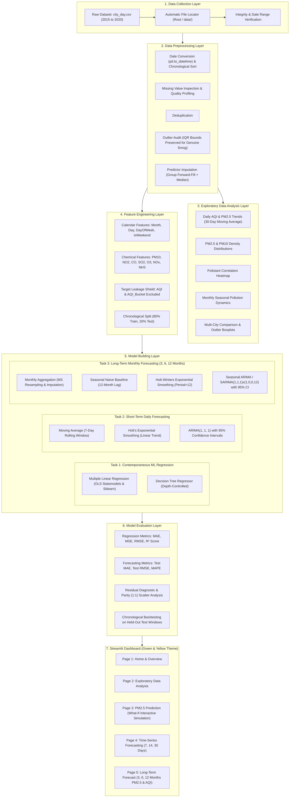

# Air Quality Prediction, Analysis & Forecasting System

[](https://www.python.org/)
[](https://streamlit.io/)
[](https://scikit-learn.org/)
[](https://www.statsmodels.org/)
[](LICENSE)

A modern, climate-tech inspired Environmental Analytics and Data Science platform developed in Python and Streamlit. Built on historical daily records from the Central Pollution Control Board (CPCB) of India, this platform delivers comprehensive exploratory data analysis, machine learning regression for contemporaneous fine particulate matter ($PM_{2.5}$) estimation, short-term daily forecasting (7, 14, 30 days), and long-term multi-horizon monthly forecasting (3, 6, 12 months) for both $PM_{2.5}$ and Air Quality Index (AQI).

---

## 1. Project Title
**Air Quality Prediction and Analysis Using Machine Learning and Time-Series Forecasting**

---

## 2. Abstract
Ambient air pollution is among the most severe global environmental health threats. Particulate matter with an aerodynamic diameter $\le 2.5\ \mu\text{m}$ ($PM_{2.5}$) penetrates deeply into lung alveoli and the cardiovascular bloodstream, causing widespread health risks. This platform implements a rigorous, three-tier analytical pipeline:
1. **Multivariate Exploratory Analysis:** Profiling pollutant distributions, meteorological seasonality (winter thermal inversions vs. monsoon scavenging), and inter-pollutant chemical correlations.
2. **Contemporaneous Machine Learning Estimation:** Predicting $PM_{2.5}$ concentrations using concurrent atmospheric precursor gases ($NO_2, SO_2, CO, O_3, PM_{10}$) via **Multiple Linear Regression** (with Statsmodels OLS statistical significance diagnostics) and **Decision Tree Regressors**, strictly enforcing anti-leakage guards (excluding AQI from predictors).
3. **Multi-Horizon Time-Series Forecasting:**
   - **Short-Term Daily Projections (7, 14, 30 Days):** Moving Average, Holt's Exponential Smoothing, and ARIMA(1, 1, 1).
   - **Long-Term Monthly Projections (3, 6, 12 Months):** Aggregated monthly averages evaluated with Seasonal Naive, Holt-Winters Exponential Smoothing (period=12), and Seasonal ARIMA (SARIMA) with 95% confidence intervals for both $PM_{2.5}$ and $AQI$.

The application features a modern **Green & Yellow** climate-tech interface designed for intuitive navigation and decision support.

---

## 3. Problem Statement
Traditional physical numerical air dispersion models require intense computational resources and fine-grained meteorological data (such as vertical planetary boundary layer profiles) that are often delayed or absent. Data-driven machine learning models provide an agile alternative, but frequently suffer from critical methodological flaws:
- **Circular Data Leakage:** Using composite AQI as an input feature to predict $PM_{2.5}$, when AQI is mathematically calculated from $PM_{2.5}$.
- **Lookahead Bias:** Randomly shuffling time-series records via standard train-test splitting.
- **Blind Outlier Truncation:** Deleting extreme winter smog spikes under the mistaken assumption that high values are sensor glitches.

This system resolves these pitfalls through strictly chronological splitting, target isolation, scientific outlier preservation, and separate short-term and long-term forecasting methodologies.

---

## 4. Key Objectives
- **Comprehensive Historical Profiling:** Audit missing values, distributions, and temporal patterns across 26 Indian urban centers spanning 2015 to 2020.
- **Contemporaneous Estimation:** Predict $PM_{2.5}$ using physical chemical covariates while preventing circular leakage.
- **Short-Term Daily Forecasting:** Project daily trends over 7, 14, and 30-day horizons.
- **Long-Term Seasonal Forecasting:** Project monthly average trends over 3, 6, and 12-month horizons for $PM_{2.5}$ and official Indian $AQI$.
- **Modern Environmental Interface:** Deliver a professional, responsive 5-page dashboard adhering to a green-and-yellow visual identity.

---

## 5. Existing System vs. Proposed System

| Dimension | Conventional Academic Systems | Proposed System |
| :--- | :--- | :--- |
| **Data Partitioning** | Random shuffling (`train_test_split`) creating time leakage | **Strict chronological split (80/20)** respecting time order |
| **Feature Selection** | Often includes `AQI` as a feature (target leakage) | **Strictly excludes `AQI` and `AQI_Bucket`** to guarantee scientific validity |
| **Outlier Handling** | Blind deletion of valid severe smog events | **IQR bounds calculated for audit; authentic smog events preserved** |
| **Forecasting Scope** | Basic 1-day or 7-day linear projection | **Dual Forecasting:** Short-term (7/14/30D) + Long-term (3/6/12M) |
| **AQI Projection** | Often ignores AQI or calculates it from PM2.5 alone | **Direct AQI monthly forecasting** categorized by CPCB breakpoints |
| **User Interface** | Basic student Streamlit UI or Jupyter Notebook | **Modern Green & Yellow Climate-Tech Dashboard** with Plotly analytics |

---

## 6. Dataset Description
- **Primary Dataset:** `city_day.csv` (29,531 daily city observations, 2015–2020)
- **Monitored Variables:**
  - Identifiers: `City`, `Date`
  - Particulate Pollutants: `PM2.5`, `PM10` ($\mu\text{g/m}^3$)
  - Combustion Gases: `NO`, `NO2`, `NOx`, `NH3`, `CO` ($\text{mg/m}^3$), `SO2`, `O3` ($\mu\text{g/m}^3$)
  - Volatile Organic Compounds: `Benzene`, `Toluene`, `Xylene` ($\mu\text{g/m}^3$)
  - Composite Index: `AQI`, `AQI_Bucket`
- **Date Range:** `January 1, 2015` to `July 1, 2020`
- **Extension Files Available in Workspace:** `city_hour.csv`, `station_day.csv`, `station_hour.csv`, `stations.csv`.

---

## 7. Technology Stack
- **Language:** Python 3.12
- **Data Engineering:** Pandas 2.2+, NumPy 1.26+
- **Interactive Visualizations:** Plotly 5.18+, Matplotlib 3.8+, Seaborn 0.13+
- **Machine Learning:** Scikit-learn 1.4+
- **Time-Series & Statistics:** Statsmodels 0.14+
- **Application Framework:** Streamlit 1.30+

---

## 8. System Architecture



---

## 9. Actual Experimental Benchmark Results

Evaluated on actual historical records (Delhi held-out test splits):

### 1. Contemporaneous ML Regression (Estimating $PM_{2.5}$ from Other Pollutants)
| Model | Training MAE | Held-Out Test MAE | Held-Out Test RMSE | Held-Out Test $R^2$ | Variance Explained |
| :--- | :---: | :---: | :---: | :---: | :---: |
| **Multiple Linear Regression** | 18.74 $\mu\text{g/m}^3$ | 19.23 $\mu\text{g/m}^3$ | 25.12 $\mu\text{g/m}^3$ | **0.8447** | **84.5%** |
| **Decision Tree Regressor (Depth=6)** | 14.11 $\mu\text{g/m}^3$ | 17.19 $\mu\text{g/m}^3$ | 23.41 $\mu\text{g/m}^3$ | **0.8973** | **89.7%** |

### 2. Short-Term Daily Time-Series Forecasting (30-Day Test Horizon)
| Model | Test MAE | Test RMSE | Test MAPE | Capability |
| :--- | :---: | :---: | :---: | :--- |
| **Moving Average (7-Day)** | 9.01 $\mu\text{g/m}^3$ | 11.12 $\mu\text{g/m}^3$ | 19.21% | Fast, robust short-term smoothing baseline |
| **Holt's Exponential Smoothing** | 12.13 $\mu\text{g/m}^3$ | 15.64 $\mu\text{g/m}^3$ | 22.63% | Adapts to local directional trend |
| **ARIMA(1, 1, 1)** | 9.74 $\mu\text{g/m}^3$ | 11.37 $\mu\text{g/m}^3$ | 22.11% | Autocorrelation with 95% Confidence Intervals |

### 3. Long-Term Monthly Forecasting (6-Month Test Horizon on Delhi Data)
| Target Variable | Model | Backtest MAE | Backtest RMSE | Backtest MAPE |
| :--- | :--- | :---: | :---: | :---: |
| **PM2.5 ($\mu\text{g/m}^3$)** | Seasonal Naive (12M Baseline) | 20.60 $\mu\text{g/m}^3$ | 24.60 $\mu\text{g/m}^3$ | 40.37% |
| **PM2.5 ($\mu\text{g/m}^3$)** | Holt-Winters Exponential Smoothing | 18.68 $\mu\text{g/m}^3$ | 21.71 $\mu\text{g/m}^3$ | 35.93% |
| **PM2.5 ($\mu\text{g/m}^3$)** | SARIMA(1,1,1)x(1,0,0,12) | **18.79 $\mu\text{g/m}^3$** | **20.27 $\mu\text{g/m}^3$** | **34.42%** |
| **AQI (Index)** | Seasonal Naive (12M Baseline) | 62.53 | 70.54 | 50.09% |
| **AQI (Index)** | Holt-Winters Exponential Smoothing | **50.40** | **62.08** | **39.54%** |
| **AQI (Index)** | SARIMA(1,1,1)x(1,0,0,12) | 60.71 | 64.02 | 47.23% |

---

## 10. Dashboard Structure & Navigation

The redesigned frontend features exactly five navigation pages:

1. **🌿 Home & Overview:** Nationwide summary KPI cards, daily $PM_{2.5}$ trend with 30-day moving average and CPCB safe limits, density distributions, and empirical atmospheric insights.
2. **📊 Exploratory Data Analysis:** City-level time trends, particulate distributions, pollutant correlation heatmaps, monthly seasonality bar charts, and city comparison rankings.
3. **🤖 PM2.5 Prediction:** Two-column interactive layout with ML model selection (Linear Regression vs. Decision Tree), feature inputs/sliders, soft-yellow prediction card with CPCB advisory category badges, and actual vs. predicted parity charts.
4. **📈 Time-Series Forecasting:** 7, 14, and 30-day daily forecasting comparing Moving Average, Holt's, and ARIMA(1,1,1) with 95% confidence intervals and CSV export.
5. **🔮 Long-Term Forecast:** 3, 6, and 12-month monthly projections for $PM_{2.5}$ and official Indian $AQI$ comparing Seasonal Naive, Holt-Winters, and SARIMA models with uncertainty intervals.

---

## 11. Important Historical Data Notice

> ⚠️ **Dataset Timeframe Notice:** The active dataset ends on **July 1, 2020**. Forecasts project forward from the conclusion of these historical observations. These values represent statistical projections based on historical atmospheric patterns and do not represent live real-time conditions. Long-term forecasts are statistical estimates and become more uncertain further into the future.

---

## 12. Installation & Setup Instructions

### Step 1: Open the Project Directory
```powershell
cd d:\AirQuality
```

### Step 2: Activate the Virtual Environment
On Windows (PowerShell):
```powershell
.\.venv\Scripts\Activate.ps1
```
On macOS / Linux:
```bash
source .venv/bin/activate
```

### Step 3: Install Required Dependencies
```powershell
pip install -r requirements.txt
```

---

## 13. How to Run the Application

Start the Streamlit application:
```powershell
streamlit run app.py
```

The application will launch and open automatically in your browser at:
```
http://localhost:8501
```

---

## 14. License
This project is open-source and distributed under the [MIT License](LICENSE).
