# System Architecture: AirQuality — Environmental Analytics & Forecasting Platform

This document outlines the end-to-end architecture of the **AirQuality** platform, featuring machine learning regression, short-term daily forecasting, and long-term monthly multi-horizon forecasting (3, 6, 12 months).

---

## 1. High-Level Architectural Flowchart

```mermaid
flowchart TD
    subgraph Layer1["1. Data Collection Layer"]
        A1["Raw Dataset: city_day.csv (CPCB Indian Air Quality Records)"] --> A2["Automatic File Locator (Supports Workspace Root & data/)"]
        A2 --> A3["Integrity & Date Span Audit (2015-01-01 to 2020-07-01)"]
    end

    subgraph Layer2["2. Data Preprocessing Layer"]
        B1["Date Conversion (pd.to_datetime) & Chronological Sort"]
        B2["Missing Value Inspection & Quality Profiling"]
        B3["Duplicate Identification & Deduplication"]
        B4["Outlier Audit (IQR Bounds Preserved for Genuine Smog Events)"]
        B5["Predictor Imputation (City Forward-Fill + Median Fallback)"]
    end

    subgraph Layer3["3. Exploratory Data Analysis (EDA) Layer"]
        C1["Daily AQI & PM2.5 Time Trends (with 30-Day Moving Average)"]
        C2["Particulate Matter (PM2.5 & PM10) Density Distributions"]
        C3["Inter-Pollutant Correlation Heatmap (Green-Yellow Palette)"]
        C4["Monthly Seasonal Pollution Dynamics (Winter Peaks vs. Monsoon Dips)"]
        C5["Multi-City Concentration Ranking & IQR Dispersion Boxplots"]
    end

    subgraph Layer4["4. Feature Engineering Layer"]
        D1["Calendar Features: Month, Day, DayOfWeek, IsWeekend"]
        D2["Chemical Covariates: PM10, NO2, CO, SO2, O3, NOx, NH3"]
        D3["Target Leakage Shield: AQI & AQI_Bucket Excluded from Predictors"]
        D4["Chronological Split (80% Train, 20% Test)"]
    end

    subgraph Layer5["5. Model Building Layer"]
        subgraph SubML["Task 1: Contemporaneous ML Regression"]
            E1["Multiple Linear Regression (OLS Statsmodels Inference & Sklearn)"]
            E2["Decision Tree Regressor (Depth-Controlled to Avoid Overfitting)"]
        end
        subgraph SubST["Task 2: Short-Term Daily Forecasting"]
            E3["Moving Average (7-Day Rolling Window)"]
            E4["Holt's Exponential Smoothing (Linear Trend)"]
            E5["ARIMA(1, 1, 1) (Differencing + 95% Confidence Bounds)"]
        end
        subgraph SubLT["Task 3: Long-Term Monthly Forecasting (3, 6, 12 Months)"]
            E6["Monthly Aggregation (MS Frequency Resampling & Imputation)"]
            E7["Seasonal Naive Baseline (12-Month Lag Reference)"]
            E8["Holt-Winters Exponential Smoothing (Additive Trend & Seasonality)"]
            E9["Seasonal ARIMA / SARIMA(1,1,1)x(1,0,0,12) with 95% Confidence Intervals"]
        end
    end

    subgraph Layer6["6. Model Evaluation Layer"]
        F1["Regression Metrics: MAE, MSE, RMSE, R² Score"]
        F2["Forecasting Metrics: Test MAE, Test RMSE, MAPE"]
        F3["Residual Diagnostic & Parity (1:1) Scatter Analysis"]
        F4["Chronological Out-of-Sample Backtesting on Historical Test Sets"]
    end

    subgraph Layer7["7. Frontend & Dashboard Layer (Green & Yellow Theme)"]
        G1["Page 1: Home & Overview (KPI Cards, Nationwide Trend, Empirical Insights)"]
        G2["Page 2: Exploratory Data Analysis (Interactive Plotly Visualizations)"]
        G3["Page 3: PM2.5 Prediction (Interactive What-If Simulation & CPCB Badges)"]
        G4["Page 4: Time-Series Forecasting (7, 14, 30-Day Daily Projections)"]
        G5["Page 5: Long-Term Forecast (3, 6, 12-Month PM2.5 & AQI Projections with CI)"]
    end

    Layer1 --> Layer2
    Layer2 --> Layer3
    Layer2 --> Layer4
    Layer4 --> Layer5
    Layer5 --> Layer6
    Layer6 --> Layer7
```

---

## 2. Layer Specifications

### 1. Data Collection Layer
- **Source**: Primary data loaded from `city_day.csv` (CPCB Indian air quality dataset).
- **Date Span**: Spans from January 1, 2015 to July 1, 2020.
- **Handling**: Supports dataset in either the workspace root or `data/` subfolder, with clear error handling.

### 2. Data Preprocessing Layer
- **Target Integrity**: Records lacking ground-truth target values are dropped for supervised modeling.
- **Imputation Strategy**: Forward fill within city groups (reflecting atmospheric inertia) followed by median replacement.
- **Outlier Preservation**: In air quality science, extreme spikes during winter inversions and stubble burning represent authentic ecological hazards rather than measurement errors; IQR statistics are calculated for audit, but authentic observations are preserved.

### 3. Feature Engineering Layer
- **Calendar Signals**: Extracted Month, Day, Day of Week, and Weekend indicators.
- **Leakage Prevention**: `AQI` and `AQI_Bucket` are excluded from regression features to prevent circular reasoning.
- **Chronological Split**: Enforces an 80/20 train/test split strictly by time to prevent temporal autocorrelation leakage.

### 4. Modeling Layers
1. **Contemporaneous ML Estimation**:
   - Multiple Linear Regression with OLS diagnostics.
   - Decision Tree Regressor with restricted depth (`max_depth=6`).
2. **Short-Term Daily Forecasting (7, 14, 30 Days)**:
   - Moving Average (7-day window).
   - Holt's Linear Exponential Smoothing.
   - ARIMA(1, 1, 1) with 95% confidence intervals.
3. **Long-Term Monthly Forecasting (3, 6, 12 Months)**:
   - Daily observations aggregated into monthly averages (`MS` frequency).
   - Target selectable: `PM2.5` or `AQI` (using Indian National AQI breakpoints).
   - Seasonal Naive baseline (12-month lag).
   - Holt-Winters Exponential Smoothing (additive trend, additive seasonality, period=12).
   - SARIMA(1, 1, 1) x (1, 0, 0, 12) with analytical 95% confidence bounds.

### 5. Frontend & UI Design System
- Modern environmental/climate-tech visual identity:
  - Forest Green (`#14532D`, `#166534`), Fresh Green (`#22C55E`, `#DCFCE7`), Soft & Accent Yellow (`#FDE68A`, `#EAB308`).
  - Rounded cards (12–16px), subtle shadows, responsive two-column layouts.
  - Exactly 5 navigation pages with zero clutter.
